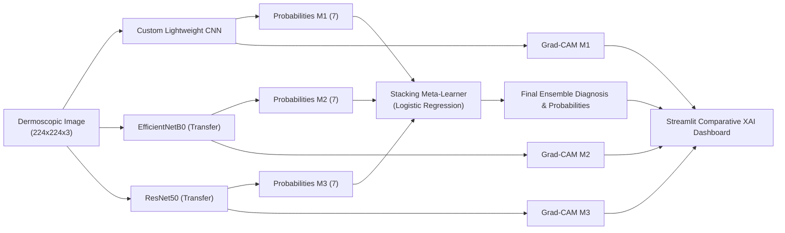

# DermaStack-XAI: An Explainable Multi-Model Deep Learning Framework for Skin Lesion Classification

[](https://python.org)
[](https://tensorflow.org)
[-green.svg)](https://scikit-learn.org)
[](https://streamlit.io)
[](tests/)

---

## 1. Project Overview

**DermaStack-XAI** is an advanced deep learning framework designed for reproducible, explainable, and multi-model classification of pigmented skin lesions across the seven diagnostic categories of the **HAM10000** dataset.

The system addresses fundamental challenges in computer-aided dermatology:
- **Class Imbalance & Extreme Rarity**: Rigorous evaluation on minority lesions (`df`, `vasc`, `akiec`) alongside majority classes (`nv`).
- **Data Leakage Prevention**: Strict patient-level grouping (`lesion_id`) preventing repeated lesion images from leaking across train, validation, and test sets.
- **Out-of-Fold Stacking Ensemble**: Multi-model integration combining a Custom Lightweight CNN, EfficientNetB0, and ResNet50 using Logistic Regression trained strictly on out-of-fold cross-validated predictions.
- **Visual Explainability (Grad-CAM)**: Multi-model comparative gradient heatmaps that highlight anatomical lesion regions contributing to classification decisions.
- **Interactive Research UI**: Clinical prototype interface built with Streamlit featuring real-time analysis, class probabilities, and visual explainability.

> [!CAUTION]
> **MANDATORY MEDICAL & RESEARCH DISCLAIMER**  
> DermaStack-XAI is an experimental academic prototype designed for research and educational purposes. It is **NOT** a certified medical diagnostic device and has not received FDA clearance or CE certification. Algorithmic outputs, probability metrics, and Grad-CAM heatmaps do **NOT** prove or confirm a diagnosis. The tool must never replace clinical assessment, dermatoscopy, or histopathology performed by a qualified dermatologist.

---

## 2. Seven Diagnostic Categories (HAM10000)

| Category Code | Full Diagnosis Name | Typical HAM10000 Count |
| :---: | :--- | :---: |
| **`akiec`** | Actinic Keratoses and Intraepithelial Carcinoma | 327 |
| **`bcc`** | Basal Cell Carcinoma | 514 |
| **`bkl`** | Benign Keratosis-like Lesions | 1,099 |
| **`df`** | Dermatofibroma | 115 |
| **`mel`** | Melanoma | 1,113 |
| **`nv`** | Melanocytic Nevi (Common Moles) | 6,705 |
| **`vasc`** | Vascular Lesions | 142 |

---

## 3. System Architecture & Model Pipeline



---

## 4. Directory Structure

```text
K:\DERMASTACK-XAI\
├── .gitignore                          # Excludes raw images, checkpoints, caches
├── requirements.txt                    # Verified dependency specifications
├── README.md                           # Master project guide
├── configs/
│   └── default_config.json             # Central configuration file
├── data/
│   ├── raw/                            # Ingestion folder for HAM10000 dataset
│   ├── processed/                      # Preprocessed cache files
│   └── splits/                         # Serialized patient-aware split manifests
├── src/
│   ├── __init__.py
│   ├── config.py                       # Dataclass-based settings & paths
│   ├── utils/
│   │   ├── logger.py                   # Structured console/file logging
│   │   └── seed.py                     # Deterministic random seeding
│   └── data/
│       └── splitter.py                 # StratifiedGroupKFold on lesion_id
├── app/
│   ├── app.py                          # Streamlit clinical research application
│   └── README.md                       # Streamlit UI instructions
├── artifacts/
│   ├── checkpoints/                    # Saved Keras base model weights
│   ├── meta_models/                    # Serialized Logistic Regression meta-learner
│   ├── metrics/                        # Benchmark results & classification reports
│   └── figures/                        # Generated confusion matrices & ROC curves
├── tests/
│   ├── test_environment.py             # Environment & configuration test suite
│   └── test_data_leakage.py            # Patient-level leakage prevention test suite
└── docs/
    ├── ARCHITECTURE.md                 # System architecture & dataflow diagrams
    ├── SPECIFICATION.md                # Functional & non-functional requirements
    ├── DATASET_GUIDELINES.md           # HAM10000 guidelines & duplicate audit
    ├── IMPLEMENTATION_CHECKLIST.md     # 9-stage roadmap with verification criteria
    ├── TESTING_STRATEGY.md             # Testing pyramid & QA protocol
    └── SESSION_1_REPORT.md             # Initialization & environment report
```

---

## 5. Quickstart & Verification

### Running Automated Tests
The project features an automated test suite verifying dependencies, configurations, and data leakage prevention:

```bash
# Execute full test suite
py -3.12 -m unittest discover -s tests -p "test_*.py" -v
```

### Launching the Streamlit Application
```bash
# Start the local research prototype UI
py -3.12 -m streamlit run app/app.py
```

---

## 6. Project Documentation Index

- [System Architecture](docs/ARCHITECTURE.md)
- [Requirements Specification](docs/SPECIFICATION.md)
- [Dataset Guidelines & Leakage Protocol](docs/DATASET_GUIDELINES.md)
- [Implementation Checklist & Roadmap](docs/IMPLEMENTATION_CHECKLIST.md)
- [Testing Strategy & QA](docs/TESTING_STRATEGY.md)
- [Session 1 Initialization Report](docs/SESSION_1_REPORT.md)
