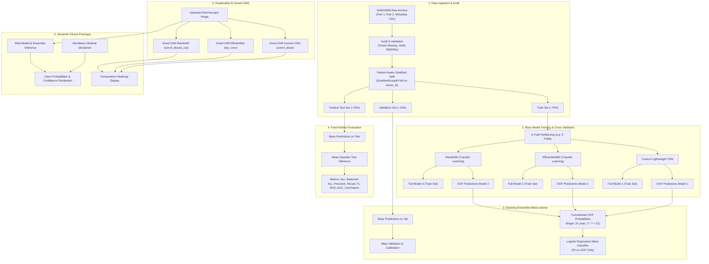

# DermaStack-XAI System Architecture

## 1. Executive Summary & Objective

**DermaStack-XAI** is an explainable, multi-model deep learning framework for dermoscopic skin lesion classification across the seven clinical categories defined by the HAM10000 benchmark dataset.

The system integrates:
1. Three diverse base convolutional neural network (CNN) architectures:
   - A **Custom Lightweight CNN** (fast, specialized, parameter-efficient)
   - **EfficientNetB0** (compound-scaled, highly parameter-efficient transfer learning)
   - **ResNet50** (deep residual representation with residual skip-connections)
2. A **Stacking Meta-Classifier** (multinomial L2-regularized Logistic Regression) trained strictly on **leakage-safe Out-Of-Fold (OOF)** cross-validated base predictions.
3. **Gradient-Weighted Class Activation Mapping (Grad-CAM)** providing visual, explainable evidence heatmaps for all base models.
4. An interactive, clinically oriented **Streamlit Web Application** equipped with mandatory medical disclaimers, class probabilities, ensemble decision rationale, and comparative heatmap views.

---

## 2. End-to-End System Diagram

---

## 3. Component Architecture

### 3.1 Data Module (`src/data/`)
- **`dataset.py`**: Manages dataset verification, loading metadata, verifying file integrity on disk, mapping classes to integer targets, and generating `tf.data.Dataset` pipelines.
- **`splitter.py`**: Implements **`StratifiedGroupKFold`** using `lesion_id` (or `patient_id`) as group identifiers. Guarantees that multiple images of the same lesion or patient never cross train/validation/test boundaries.
- **`transforms.py`**: Defines data preprocessing and augmentation.
  - Normalization: Model-specific scaling (`rescaling 1/255` for Custom CNN, standard EfficientNet/ResNet normalization functions).
  - Augmentation: Horizontal/vertical flips, subtle rotation ($\pm 20^\circ$), zoom ($\pm 10\%$), applied **strictly to training folds**.

### 3.2 Model Definitions (`src/models/`)
- **`custom_cnn.py`**:
  - 4 Sequential blocks: `Conv2D` $\rightarrow$ `BatchNormalization` $\rightarrow$ `ReLU` $\rightarrow$ `MaxPooling2D`.
  - `GlobalAveragePooling2D` $\rightarrow$ `Dense(128, relu)` $\rightarrow$ `Dropout(0.4)` $\rightarrow$ `Dense(7, softmax)`.
  - Total parameters: $\approx 500\text{K} - 1.2\text{M}$ (lightweight and interpretable).
- **`efficientnet.py`**:
  - Backbone: `EfficientNetB0` initialized with ImageNet weights.
  - Head: `GlobalAveragePooling2D` $\rightarrow$ `BatchNormalization` $\rightarrow$ `Dropout(0.4)` $\rightarrow$ `Dense(7, softmax)`.
  - Staged training: Feature extraction (frozen base) $\rightarrow$ fine-tuning top layers.
- **`resnet.py`**:
  - Backbone: `ResNet50` initialized with ImageNet weights.
  - Head: `GlobalAveragePooling2D` $\rightarrow$ `Dense(256, relu)` $\rightarrow$ `Dropout(0.5)` $\rightarrow$ `Dense(7, softmax)`.
- **`stacking_meta.py`**:
  - Meta-classifier: Multinomial `LogisticRegression(C=1.0, penalty='l2', solver='lbfgs', max_iter=1000)`.
  - Input: Concatenated prediction probability vectors from the 3 base models ($[p_{m1, 1\dots7}, p_{m2, 1\dots7}, p_{m3, 1\dots7}] \in \mathbb{R}^{21}$).
  - Output: Ensembled class probability distribution over the 7 classes.

### 3.3 Training & Cross-Validation (`src/training/`)
- **`trainer.py`**:
  - Loss: Categorical Cross-Entropy (with optional class weights to handle extreme imbalance, e.g., `nv` vs `df`).
  - Optimizer: Adam with initial learning rate $1\times 10^{-4}$.
  - Callbacks: `EarlyStopping(patience=7, restore_best_weights=True)`, `ReduceLROnPlateau(patience=3, factor=0.5)`, `ModelCheckpoint`.
  - Out-of-fold matrix generation: Saves validation probability predictions for each fold to construct the training set for the stacking meta-learner without data leakage.

### 3.4 Explainable AI (XAI) Module (`src/xai/`)
- **`gradcam.py`**:
  - Extracts the gradient of the winning (or selected) class score with respect to feature maps of the final convolutional layer:
    - Custom CNN: `conv4_block`
    - EfficientNetB0: `top_conv`
    - ResNet50: `conv5_block3_out`
  - Computes channel-wise mean gradients $\alpha_k^c = \frac{1}{Z}\sum_i \sum_j \frac{\partial y_c}{\partial A_{i,j}^k}$.
  - Computes weighted linear combination followed by ReLU: $L_{\text{Grad-CAM}}^c = \text{ReLU}\left(\sum_k \alpha_k^c A^k\right)$.
  - Upsamples heatmap to $(224, 224)$, normalizes to $[0, 1]$, and overlays with `jet` colormap onto the original dermatoscopic image.

### 3.5 Evaluation & Reporting (`src/evaluation/`)
- **`metrics.py`**: Computes Multiclass Confusion Matrix, Classification Report (Precision, Recall, F1 per class, macro avg, weighted avg), Balanced Accuracy, and Macro One-vs-Rest ROC-AUC.
- **`plots.py`**: Generates publication-ready figures for confusion matrices, ROC curves, class distribution bar charts, and training/validation loss curves.

### 3.6 Application Layer (`app/`)
- **`app.py`**: Streamlit application providing:
  - Secure image upload (JPEG/PNG).
  - Model selection toggle (Individual Base Model vs Stacking Ensemble).
  - Diagnostic prediction view: Class ranking, probability gauge, risk classification.
  - Side-by-side visual comparison of Grad-CAM heatmaps across all three base architectures.
  - Clinical metadata explainer (lesion category explanation, common biological features).
  - Clear, permanent research prototype disclaimer banner.
