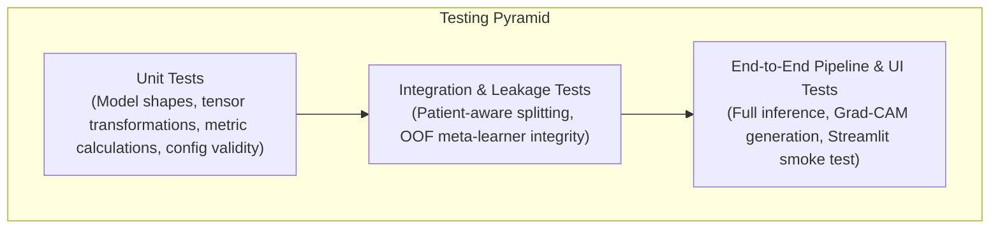

# DermaStack-XAI Testing Strategy & Quality Assurance Framework

## 1. Testing Philosophy & Standards

To ensure scientific rigor, clinical safety awareness, and reproducibility, **DermaStack-XAI** follows a comprehensive testing hierarchy. All tests use Python's built-in `unittest` framework (guaranteeing execution in clean environments without requiring external third-party test runners).



---

## 2. Test Suite Breakdown

### 2.1 Environment & Configuration Verification (`tests/test_environment.py`)
- **Objective**: Confirm that the execution environment satisfies all technical requirements.
- **Assertions**:
  - Python version is $\ge 3.10$ and $< 3.13$.
  - Required packages (`tensorflow`, `keras`, `sklearn`, `pandas`, `numpy`, `PIL`, `streamlit`) are importable.
  - Project directory paths in `src/config.py` resolve correctly.
  - Random seed functions set seeds deterministically.

### 2.2 Data Leakage & Split Verification (`tests/test_data_leakage.py`)
- **Objective**: Mathematically prove that no identical lesion appears in multiple splits.
- **Assertions**:
  - `len(set(train_lesions) & set(val_lesions)) == 0`
  - `len(set(train_lesions) & set(test_lesions)) == 0`
  - `len(set(val_lesions) & set(test_lesions)) == 0`
  - All 7 classes are present in both train, validation, and test splits.
  - Total number of partitioned records equals total number of valid input records.

### 2.3 Model Architecture & Shape Verification (`tests/test_models.py`)
- **Objective**: Verify that model architectures initialize correctly and produce expected tensor shapes.
- **Assertions**:
  - Input tensor shape `(batch_size, 224, 224, 3)` processes without errors.
  - Output tensor shape is strictly `(batch_size, 7)`.
  - Output activation sums to $1.0 \pm 10^{-5}$ across channels (valid Softmax probability distribution).
  - Parameter counts for the Custom CNN stay within the lightweight budget ($< 2\text{M}$ parameters).

### 2.4 Stacking Ensemble & Out-of-Fold Integrity (`tests/test_stacking.py`)
- **Objective**: Confirm that the stacking meta-classifier cannot ingest in-sample training predictions.
- **Assertions**:
  - Meta-classifier input dimension matches $3 \times 7 = 21$ features.
  - Meta-classifier predicts valid probability vectors of length 7.
  - Out-of-fold matrix shape equals $(N_{\text{train}}, 21)$.

### 2.5 Grad-CAM Verification (`tests/test_gradcam.py`)
- **Objective**: Ensure that the gradient backpropagation generates valid, non-degenerate heatmaps.
- **Assertions**:
  - Generated heatmap is a 2D float array normalized between $0.0$ and $1.0$.
  - Heatmap dimensions match input image dimensions $(224, 224)$.
  - Overlay function produces an RGB image of uint8 values in range $[0, 255]$.
  - No NaN or Infinite values appear during gradient tape operations.

---

## 3. Running the Test Suite

Run tests via Python's standard runner:

```bash
# Run all unit and integration tests
py -3.12 -m unittest discover -s tests -p "test_*.py" -v

# Run individual test modules
py -3.12 -m unittest tests.test_environment -v
py -3.12 -m unittest tests.test_data_leakage -v
py -3.12 -m unittest tests.test_models -v
```
